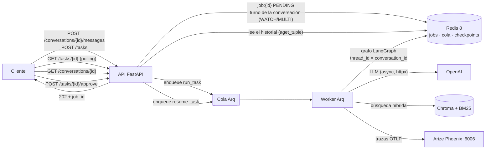
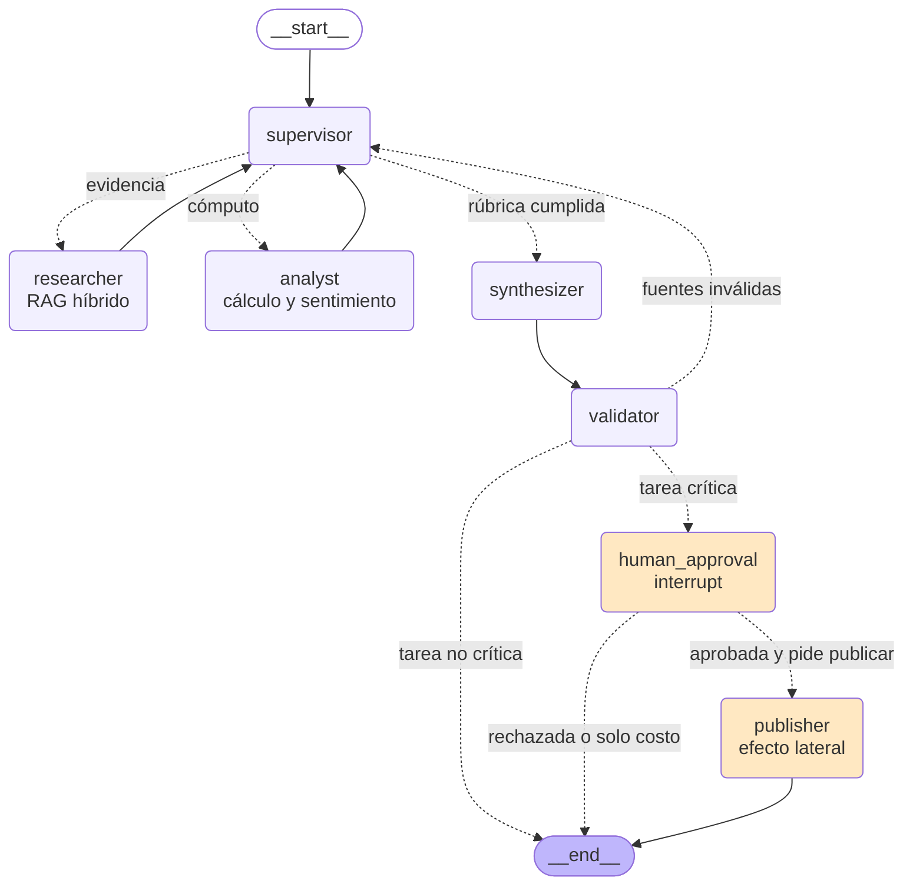

# The Intelligence System

Entrega final de Coderhouse · AI Engineering. Sistema de IA de grado de producción para TechCorp que responde consultas complejas sobre su base documental interna: un **Supervisor** (LangGraph) delega en agentes especializados que buscan evidencia con **RAG híbrido**, calculan y redactan una respuesta citada y validada. Se expone como una **API REST asíncrona** (FastAPI + Arq + Redis), las **conversaciones persisten** en Redis con el checkpointer de LangGraph y cada ejecución deja una **traza completa** en Arize Phoenix.

## En cinco minutos

> Un cliente envía una pregunta a la API, que responde `202` con un `job_id` en milisegundos y nunca ejecuta el grafo. Un worker toma el job de la cola, ejecuta el grafo de agentes sobre el *thread* de la conversación y guarda cada transición de estado en Redis. El Supervisor decide, con salida estructurada validada por Pydantic, si hace falta evidencia (Investigador con búsqueda híbrida BM25 + densa), cómputo (Analista con herramientas deterministas) o si ya puede sintetizar; guardas en código impiden bucles. Un validador determinista rechaza respuestas que citan fuentes no recuperadas. Si la tarea es crítica (publicar un informe o un costo alto), el grafo se detiene con `interrupt()` hasta que una persona la aprueba. Todo es `async`, todo lo configurable sale del entorno y todo deja spans en Phoenix con tokens, costo y latencia.

| Capacidad pedida | Cómo se cumple |
| --- | --- |
| Conocimiento específico (RAG) | Chroma + BM25 fusionados con RRF sobre el corpus de TechCorp; el Investigador cita `[Fuente: archivo]` |
| Razonamiento multi-paso | Supervisor + Investigador + Analista + Síntesis + Validación, con condiciones de parada y reintento |
| API profesional y documentada | FastAPI con contratos Pydantic en cada endpoint, OpenAPI en `/docs`, códigos 202/404/409/422/503 |
| Trazabilidad | OpenInference → Phoenix: un span por nodo, agente, herramienta y llamada al LLM; `trace_id` en cada respuesta |
| Persistencia | `AsyncRedisSaver`: las conversaciones y las tareas en pausa sobreviven a reinicios |
| Despliegue local | `./run.sh` o `docker compose up -d --build` |

## Arquitectura



### Grafo de agentes



| Nodo | Qué hace |
| --- | --- |
| `supervisor` | Decide quién interviene (`SupervisorDecision`, salida estructurada). Ve la consulta, las contribuciones del turno y el historial reciente; aplica guardas: `MAX_STEPS`, `MAX_REVISIONS` por especialista |
| `researcher` | Agente ReAct con `buscar_documentos` (RAG híbrido) y `listar_documentos`. Solo recibe la instrucción del supervisor. Las fuentes se toman del artifact de la herramienta, no del texto del LLM |
| `analyst` | Agente ReAct con `calcular` (evaluador AST, sin `eval`), `estadisticas`, `variacion_porcentual` y `analizar_sentimiento`. Recibe la instrucción y los datos del investigador |
| `synthesizer` | Redacta la respuesta usando solo las contribuciones y cita `[Fuente: archivo]` |
| `validator` | Rúbrica determinista: respuesta vacía, fuentes inventadas o sin citar → vuelve al supervisor (`MAX_VALIDATION_RETRIES`) |
| `human_approval` | `interrupt()` con un `ApprovalRequest` validado; el checkpoint queda en Redis hasta `POST /tasks/{id}/approve` |
| `publisher` | Ejecuta `publicar_informe` (escribe `reports/informe_{job_id}.md`) solo si se aprobó |

### De dónde sale cada pieza

| Módulo del curso | En este repositorio |
| --- | --- |
| M1 · Cliente async robusto | `app/llm/client.py`: SDK async de OpenAI con timeout y reintentos con backoff |
| M2 · LCEL y contratos de datos | Salida estructurada del supervisor, contratos Pydantic de herramientas (`app/tools/schemas.py`) |
| M3 · RAG local | `app/rag/corpus.py`: corpus Markdown, chunking por secciones, Chroma + embeddings multilingües locales |
| M4 · RAG híbrido | `app/rag/retriever.py`: BM25 + densa con Reciprocal Rank Fusion, deduplicación por `chunk_id` |
| M5 · Agente ReAct con memoria | Checkpointer por `thread_id`, ahora en Redis (`app/storage/checkpointer.py`) |
| M6 · Orquestador multi-agente | `app/agents/`, `app/graph/`: supervisor, especialistas, síntesis y validación |
| M7 · API de producción | `app/api/`, `app/worker/`, `app/storage/`, `app/observability/`: FastAPI, Arq, Redis, HITL, Phoenix |

Las decisiones de diseño y sus alternativas están en [`docs/decisiones.md`](docs/decisiones.md).

## Estructura

| Ruta | Qué contiene |
| --- | --- |
| `app/core/` | `config.py` (Settings validadas con `pydantic-settings`) y `logging.py` (logs con `job_id`, `conversation_id`, `trace_id`) |
| `app/llm/` | Cliente del LLM |
| `app/rag/` | Corpus, chunking y `HybridRetriever` |
| `app/tools/` | Herramientas de los agentes y sus contratos Pydantic |
| `app/agents/` | Supervisor, investigador, analista, sintetizador y validador |
| `app/graph/` | Estado (con reducers por turno), prompts, nodos HITL, construcción del grafo y entrada de cada turno |
| `app/storage/` | `JobStore`, `ConversationStore` y checkpointer `AsyncRedisSaver` |
| `app/api/` | FastAPI: `main.py`, contratos (`schemas.py`), dependencias y routers |
| `app/worker/` | Worker de Arq: `run_task`, `resume_task` y transiciones de estado |
| `app/observability/` | Phoenix, `LangChainInstrumentor`, span raíz y `trace_id` |
| `app/data/` | Corpus de TechCorp (5 documentos) |
| `scripts/` | `e2e_demo.py` (las 5 pruebas), `load_test.py` (5 peticiones concurrentes), `ingest.py` |
| `tests/` | Tests sin red, sin API key, sin Redis y sin Phoenix |
| `screenshots/` | Evidencia de las trazas en Phoenix |

## Puesta en marcha

Requisitos: Docker con Compose v2 y una API key de OpenAI. Python 3.12+ solo hace falta para los scripts y los tests.

### Un solo comando

| Sistema | Comando |
| --- | --- |
| Windows (PowerShell o cmd) | `.\run.cmd` (o `.\run.ps1` si la política de ejecución lo permite) |
| Linux, macOS, Git Bash o WSL | `./run.sh` |

```powershell
.\run.cmd
```

```bash
./run.sh
```

Los tres scripts hacen lo mismo: verifican que Docker esté instalado y corriendo, crean `.env` desde `.env.example` si no existe, comprueban que `OPENAI_API_KEY` esté completa (sin mostrarla), construyen las imágenes, levantan Redis, Phoenix, la API y el worker, esperan a que la API esté sana e imprimen las URLs. También aceptan `down`, `logs` y `status` (por ejemplo, `.\run.cmd logs`). `run.cmd` existe porque Windows suele bloquear los `.ps1` descargados (política de ejecución); lanza `run.ps1` con `-ExecutionPolicy Bypass` solo para ese proceso, sin cambiar la configuración del sistema.

Sin scripts, el equivalente manual es:

```powershell
Copy-Item .env.example .env    # y completar OPENAI_API_KEY
docker compose up -d --build
```

La diferencia es que `docker compose up` no valida nada: si falta la clave, los contenedores arrancan igual, el worker se reinicia en bucle y las tareas quedan en `PENDING`; además, el comando termina antes de que la API esté lista.

- API y documentación interactiva: http://localhost:8000/docs
- Dashboard de Phoenix: http://localhost:6006

El primer arranque del worker descarga el modelo de embeddings e indexa el corpus (quedan en volúmenes de Docker, así que los siguientes arranques son inmediatos). Los informes publicados aparecen en `reports/`. Para detener todo: `.\run.cmd down` o `./run.sh down`; para ver los logs: `.\run.cmd logs` o `./run.sh logs`.

### Variables de entorno

Todas se documentan en [`.env.example`](.env.example) y se validan al arrancar (`app/core/config.py`). Las obligatorias son `OPENAI_API_KEY` (solo el worker), `OPENAI_MODEL`, `CHROMA_COLLECTION` y `EMBEDDING_MODEL`: el código no tiene nombres de modelos ni de índices escritos.

| Grupo | Variables |
| --- | --- |
| LLM | `OPENAI_API_KEY`, `OPENAI_MODEL`, `LLM_TIMEOUT_SECONDS`, `LLM_MAX_RETRIES` |
| RAG | `CHROMA_COLLECTION`, `EMBEDDING_MODEL`, `TOP_K`, `RETRIEVAL_CANDIDATES`, `HYBRID_BM25_WEIGHT`, `HYBRID_DENSE_WEIGHT`, `RRF_K`, `CHUNK_SIZE`, `CHUNK_OVERLAP` |
| Orquestador | `MAX_STEPS`, `MAX_REVISIONS`, `MAX_VALIDATION_RETRIES`, `HISTORY_TURNS` |
| Infraestructura | `REDIS_URL`, `JOB_TIMEOUT_SECONDS`, `WORKER_MAX_JOBS`, `JOB_TTL_SECONDS`, `CONVERSATION_TTL_MINUTES` |
| HITL | `COST_APPROVAL_TOKEN_THRESHOLD` |
| Observabilidad | `PHOENIX_ENABLED`, `PHOENIX_COLLECTOR_ENDPOINT`, `PHOENIX_PROJECT_NAME`, `PHOENIX_API_KEY` |

## Uso de la API

| Método y ruta | Qué hace | Respuestas |
| --- | --- | --- |
| `POST /conversations` | Crea una conversación | 201 |
| `POST /conversations/{id}/messages` | Encola un turno de la conversación | 202, 404, 409 (turno en curso), 422, 503 |
| `GET /conversations/{id}` | Historial (leído del checkpoint) y jobs de la conversación | 200, 404 |
| `POST /tasks` | Atajo: conversación nueva de un solo turno | 202, 422, 503 |
| `GET /tasks/{job_id}` | Estado del job, resultado y `trace_id` | 200, 404 |
| `POST /tasks/{job_id}/approve` | Aprueba o rechaza una tarea en pausa | 202, 404, 409, 422, 503 |
| `GET /health` | Verifica Redis | 200, 503 |

Conversación de dos turnos:

```bash
curl -X POST http://localhost:8000/conversations
```

```json
{"conversation_id": "9f2c...", "messages_url": "/conversations/9f2c.../messages"}
```

```bash
curl -X POST http://localhost:8000/conversations/9f2c.../messages -H "Content-Type: application/json" -d "{\"query\": \"¿Cuántos días de vacaciones corresponden con 3 años de antigüedad?\"}"
```

```json
{"job_id": "3cd1...", "conversation_id": "9f2c...", "status": "PENDING", "status_url": "/tasks/3cd1...", "conversation_url": "/conversations/9f2c..."}
```

```bash
curl http://localhost:8000/tasks/3cd1...
```

Cuando el estado es `DONE`, `result` trae `final_answer`, `route`, `decisions`, `sources`, `tokens_used` y `total_tokens`, y `trace_id` identifica la traza en Phoenix. La repregunta usa el mismo `messages_url`:

```bash
curl -X POST http://localhost:8000/conversations/9f2c.../messages -H "Content-Type: application/json" -d "{\"query\": \"¿Y con 12 años? ¿En qué porcentaje supera al caso anterior?\"}"
```

Tarea crítica (pide publicar el informe):

```bash
curl -X POST http://localhost:8000/tasks -H "Content-Type: application/json" -d "{\"query\": \"Calcula la variación del eNPS 2025 respecto de 2024 y publica el informe\", \"publish\": true}"
```

Cuando su estado pase a `WAITING_APPROVAL`, `approval_request` muestra los motivos y una vista previa. Para aprobarla (o rechazarla con `"approved": false`):

```bash
curl -X POST http://localhost:8000/tasks/<job_id>/approve -H "Content-Type: application/json" -d "{\"approved\": true, \"comment\": \"Revisado por RR. HH.\"}"
```

### Estados de un job

| Estado | Significado |
| --- | --- |
| `PENDING` | Encolado (o reencolado tras la aprobación), esperando un worker |
| `RUNNING` | El worker está ejecutando el grafo |
| `WAITING_APPROVAL` | Pausado en `human_approval`; la conversación no acepta mensajes nuevos hasta resolverlo |
| `DONE` | Terminado; `result` trae la respuesta |
| `REJECTED` | Un revisor rechazó la acción crítica |
| `FAILED` | Excepción o `JOB_TIMEOUT_SECONDS` superado; `error` trae el tipo y el mensaje |

El worker envuelve cada ejecución en `try/except` y `asyncio.timeout`: cualquier error del agente, del LLM o de Redis deja el job en `FAILED` y libera el turno de la conversación, de modo que el cliente siempre llega a un estado terminal. Arq usa `max_tries=1` para no reintentar a ciegas.

## Persistencia: qué sobrevive a un reinicio

- **Conversaciones:** el historial de mensajes vive en el checkpointer `AsyncRedisSaver` bajo `thread_id = conversation_id`. Tras `docker compose restart api worker`, un nuevo mensaje continúa la conversación con todo su contexto (la prueba 4 de la demo lo demuestra).
- **Tareas en pausa:** una tarea en `WAITING_APPROVAL` puede aprobarse después de reiniciar; cualquier worker la reanuda desde el checkpoint.
- **Redis:** AOF activado y volumen `redis-data`, así que también sobrevive a un reinicio del contenedor de Redis.
- **Estado por turno:** `contributions`, `decisions` y `tokens_used` se reinician en cada turno (reducers `extend_or_reset` y `add_or_reset` en `app/graph/state.py`); `messages` y `total_tokens` se acumulan.

## Validación con Pydantic

- **API:** `MessageRequest` (consulta de 3 a 2000 caracteres, sin espacios vacíos), `ApprovalDecision`, `TaskCreated`, `TaskStatusResponse`, `TaskResult`, `ConversationOut`, `ErrorResponse`. El worker valida el resultado con `TaskResult` antes de guardarlo.
- **Herramientas:** cada una declara `args_schema` (`app/tools/schemas.py`) y devuelve un artifact validado (`ResultadoBusqueda`, `ResultadoCalculo`, `Estadisticas`, `ResultadoVariacion`, `ResultadoSentimiento`, `InformePublicado`). Si el LLM propone argumentos inválidos (por ejemplo, `valor_inicial = 0` o `k = 50`), recibe el error como mensaje y corrige la llamada.
- **Grafo:** `SupervisorDecision` (salida estructurada del LLM), `ApprovalRequest` (payload de `interrupt()`) y `ApprovalDecision` (valor de reanudación).
- **Configuración:** `Settings` valida tipos y rangos de todas las variables de entorno al arrancar.

## Observabilidad: las 5 pruebas

Con el sistema levantado:

```bash
python scripts/e2e_demo.py
```

| # | Prueba | Qué demuestra |
| --- | --- | --- |
| 1 | RAG simple (contraseñas) | Investigador + búsqueda híbrida + citas |
| 2 | RAG + cálculo (teletrabajo) | Delegación investigador → analista → síntesis |
| 3 | RAG + sentimiento (encuesta de clima) | Herramienta de sentimiento sobre datos recuperados |
| 4 | Conversación de 2 turnos con reinicio de API y worker en el medio | Checkpointer: la repregunta se resuelve con el historial persistido |
| 5 | Tarea crítica con publicación | `interrupt()` → aprobación → reanudación → informe publicado |

El script imprime, por prueba, `job_id`, `conversation_id`, `trace_id`, estado, latencia y tokens. En Phoenix (http://localhost:6006, proyecto **intelligence-system**):

- **Traces:** cada job es una traza con raíz `job_turno` y el árbol `LangGraph → supervisor / researcher / analyst / synthesizer / validator / human_approval / publisher`, con las llamadas al LLM y a las herramientas (`buscar_documentos`, `calcular`...). Las columnas muestran latencia, tokens y costo.
- **Sessions:** agrupa los turnos de una conversación (prueba 4) y la ejecución inicial y la reanudación de la tarea crítica (prueba 5).
- **Metrics:** latencia por percentiles (P50/P95/P99), costo y uso de tokens.

Para 5 peticiones concurrentes y percentiles del lado del cliente: `python scripts/load_test.py --auto-approve`.

### Pruebas manuales con Postman

La carpeta [`postman/`](postman/) tiene la colección `intelligence_system.postman_collection.json` y el entorno `local.postman_environment.json` (importe ambos con *File → Import*). La colección replica las 5 pruebas, más una carpeta de sistema y otra de errores:

| Carpeta | Peticiones |
| --- | --- |
| 0. Sistema | `GET /health`, `GET /openapi.json` |
| Prueba 1 a 3 | Crear tarea → consultar estado hasta `DONE` |
| Prueba 4 | Crear conversación → turno 1 → (reiniciar con `docker compose restart api worker`) → turno 2 → historial |
| Prueba 5 | Crear tarea crítica → estado hasta `WAITING_APPROVAL` → aprobar (o rechazar) → estado final |
| 6. Errores y validación | 404, 422 (validación Pydantic) y 409 (aprobación fuera de pausa, conversación ocupada) |

- Las peticiones "Crear" guardan `job_id` y `conversation_id` en variables de la colección, así las siguientes funcionan sin copiar ids.
- Las consultas de estado se reenvían a mano hasta que el job termina; en el *Collection Runner* se repiten solas cada 5 s hasta el estado esperado.
- Cada petición trae respuestas de ejemplo (*Examples*): 202, 200 en curso y terminado, en pausa, aprobado, rechazado y cada error. Los ids, tokens y textos de los ejemplos son ilustrativos.
- Los tests de cada petición validan el código HTTP y el estado; la consola de Postman muestra tokens, ruta de agentes, `trace_id` y la respuesta final.

### Evidencia

Las capturas están en [`screenshots/`](screenshots/README.md).

| Prueba | Estado | Latencia | Tokens | Costo | Traza |
| --- | --- | --- | --- | --- | --- |
| 1. RAG simple | _completar_ | _s_ | _ _ | _US$_ | `screenshots/01_rag_simple.png` |
| 2. RAG + cálculo | _completar_ | _s_ | _ _ | _US$_ | `screenshots/02_rag_calculo.png` |
| 3. RAG + sentimiento | _completar_ | _s_ | _ _ | _US$_ | `screenshots/03_rag_sentimiento.png` |
| 4. Conversación con reinicio | _completar_ | _s_ | _ _ | _US$_ | `screenshots/04_conversacion_sessions.png` |
| 5. HITL con publicación | _completar_ | _s_ | _ _ | _US$_ | `screenshots/05_hitl.png` |

Lectura del dashboard (completar con los números de la corrida):

- **Nodo que concentra la latencia:** _ _
- **Nodo que consume más tokens:** _ _
- **Costo medio y máximo por ejecución:** _ _
- **Latencia P95:** _ _

## Tests

No usan red, API key, Redis ni Phoenix: un `ScriptedChatModel` por rol reemplaza a OpenAI, un vector store en memoria con embeddings deterministas reemplaza a Chroma (el BM25 es el real), `fakeredis` reemplaza a Redis e `InMemorySaver` al checkpointer.

```bash
pytest
```

Cubren:

- **Herramientas:** evaluador seguro, contratos Pydantic que rechazan argumentos inválidos, errores devueltos al agente como mensaje, artifacts validados, publicación con id saneado.
- **RAG híbrido:** chunking con ids estables, tokenizador, fusión RRF y pesos, recuperación léxica de términos exactos.
- **Grafo:** delegación, contexto mínimo de los especialistas, guardas contra bucles, validador.
- **Conversaciones:** reducers por turno, historial entre turnos, el supervisor ve el historial y los especialistas no, el historial sobrevive a una instancia nueva del grafo.
- **HITL:** pausa antes del efecto lateral, aprobación, rechazo, payload de reanudación inválido, umbral de tokens.
- **Worker:** `DONE`, `FAILED` por excepción y por timeout, `WAITING_APPROVAL` → `DONE`/`REJECTED`, liberación del turno.
- **API:** 202/404/409/422/503, un turno a la vez por conversación, historial leído del checkpoint, doble aprobación rechazada.
- **Estándares:** ningún módulo importa `requests`, ningún nombre de modelo escrito en `app/`, ningún voseo en código ni documentación.

## Notas

- **Redis:** el checkpointer necesita RedisJSON y RediSearch. La imagen `redis:8.2` ya los incluye; con un Redis más antiguo use `redis/redis-stack-server`.
- **Phoenix:** desde la versión 21 activa la autenticación por defecto. En `docker-compose.yml` se desactiva (`PHOENIX_ENABLE_AUTH=false`) porque es un dashboard local; en un entorno compartido, actívela y defina `PHOENIX_API_KEY`.
- **Windows:** Arq no puede instalar manejadores de señales en el event loop; el worker usa `handle_signals=False` y un alias para `SIGUSR1`, así se detiene con `Ctrl+C` ejecutando `on_shutdown` (que vacía el buffer de trazas).
- `create_react_agent` (del Módulo 6) está marcado como obsoleto en LangGraph 1.x a favor de `langchain.agents.create_agent`; sigue funcionando y se silencia su aviso.
