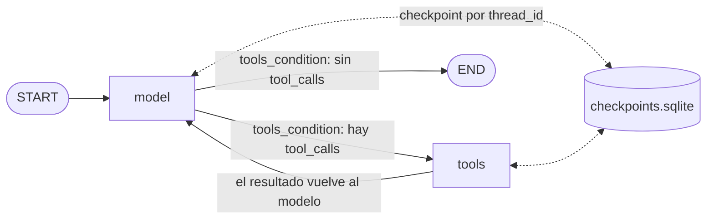

# Agente ReAct con memoria persistente

Agente de razonamiento cíclico hecho con LangGraph y OpenAI para la Pre-entrega 5. Responde consultas sobre clientes y pedidos: decide por sí mismo qué herramientas usar, reacciona a sus errores y recuerda la conversación por `thread_id`, incluso entre ejecuciones del programa.

## Arquitectura



| Módulo | Responsabilidad |
| --- | --- |
| `react_agent/config.py` | Variables de entorno, rutas y límites |
| `react_agent/data.py` | Base de datos simulada de clientes y pedidos |
| `react_agent/tools.py` | Herramientas `@tool`: `buscar_cliente`, `listar_pedidos`, `detalle_pedido` |
| `react_agent/state.py` | `AgentState`, que hereda de `MessagesState` |
| `react_agent/prompts.py` | System prompt |
| `react_agent/llm.py` | Creación de `ChatOpenAI` |
| `react_agent/graph.py` | `StateGraph` y recorte del contexto enviado al modelo |
| `react_agent/runner.py` | Checkpointer y ejecución de un turno con `recursion_limit` |
| `react_agent/trace.py` | Exportación de la traza a JSON y log |
| `chat.py` | Chat interactivo por consola |
| `run_demo.py` | Escenarios de la consigna y generación de la traza |

## Puesta en marcha

Requiere un ambiente con Python 3.12..

```bash
pip install -r requirements.txt
```

```bash
copy .env.example .env
```

Después, completa `OPENAI_API_KEY` en `.env`. Ese archivo está en `.gitignore`, así que la clave no se sube al repositorio. El modelo por defecto es `gpt-5.4-mini` y se puede cambiar con `OPENAI_MODEL`.

## Uso

Chat interactivo. Al iniciar muestra el `thread_id`, que sirve para retomar la sesión más tarde:

```bash
python chat.py
```

```bash
python chat.py --thread-id mi-sesion
```

Escenarios de la consigna, que generan `traces/traza_ejecucion.json` y `traces/traza_ejecucion.log`:

```bash
python run_demo.py
```

| Escenario | Pregunta | Qué demuestra |
| --- | --- | --- |
| `multi_paso` | ¿Cuántos pedidos tuvo Lucía Fernández y cuál fue el total? | Dos o más herramientas para una sola pregunta |
| `memoria` | ¿Y el último? (mismo `thread_id`) | Recuerda el contexto; cada turno abre su propia conexión a SQLite, así que el dato sale del disco |
| `reintento` | ¿Cuánto gastó en total Lusia Fernandes? | Error con sugerencia seguido de un segundo intento |
| `aclaracion` | ¿Cuántos pedidos tuvo Roberto Sánchez? | Sin candidatos, pide una aclaración en vez de inventar |

## Formato de la traza

La traza real está en `traces/`. Este fragmento solo ilustra el formato del log; el razonamiento y la redacción dependen de cada ejecución:

```text
Usuario: "¿Cuántos pedidos tuvo Lucía Fernández y cuál fue el total?"
-> El agente decide usar la herramienta: buscar_cliente(nombre='Lucía Fernández')
-> La herramienta devuelve: {"cliente_id": 102, "nombre": "Lucía Fernández"}
-> El agente decide usar la herramienta: listar_pedidos(cliente_id=102)
-> La herramienta devuelve: {"cantidad": 3, "total": 14500, "pedidos": [...]}
Respuesta: Lucía Fernández tuvo 3 pedidos por un total de $14.500.
```

## Decisiones de diseño

- **`AsyncSqliteSaver` en lugar de `SqliteSaver`.** La consigna pide `SqliteSaver` y gestión con `asyncio`. La clase síncrona no admite `ainvoke`, por lo que se usa su variante asíncrona, del mismo paquete `langgraph-checkpoint-sqlite` y con la misma base SQLite.
- **Sin rutas manuales.** El único enrutamiento es `tools_condition`: el modelo decide si llama a una herramienta y a cuál.
- **Errores como datos.** Las herramientas devuelven `{"error": ...}` y el modelo decide si reintenta o pide aclaración. `ToolNode(handle_tool_errors=True)` hace lo mismo con errores inesperados, como argumentos inválidos.
- **Límite de recursión.** `recursion_limit=10` permite hasta 4 rondas de herramientas y la respuesta final. Si se alcanza, el usuario recibe un mensaje claro y las `tool_calls` sin resultado se cierran para que el hilo siga siendo utilizable.
- **Contexto acotado.** Antes de cada llamada, `trim_messages` deja solo los turnos recientes (unos 4000 tokens). El historial completo queda guardado en SQLite.
- **Temperatura.** No se fija `temperature`: se usa el valor por defecto del modelo.

## Tests

No necesitan API key: usan un LLM falso con respuestas programadas sobre el grafo, las herramientas y el SQLite reales.

```bash
pytest
```

```bash
mypy react_agent chat.py run_demo.py
```

## Checklist de la consigna

| Requisito | Dónde |
| --- | --- |
| `StateGraph` que hereda de `MessagesState`, con nodos de modelo y herramientas y `tools_condition` | `react_agent/state.py`, `react_agent/graph.py` |
| Herramientas con `@tool` y docstring descriptivo | `react_agent/tools.py` |
| LLM vinculado con `bind_tools()` | `react_agent/graph.py` |
| Persistencia con SQLite y `thread_id` | `react_agent/runner.py` |
| Razonamiento multi-paso y `recursion_limit` | `run_demo.py`, `react_agent/runner.py` |
| Traza de ejecución | `traces/`, generada con `run_demo.py` |
| Python 3.12, type hints y `asyncio` | Todo el paquete, verificado con `mypy` |
| Sin API keys en el repositorio | `.env` en `.gitignore`, plantilla en `.env.example` |
