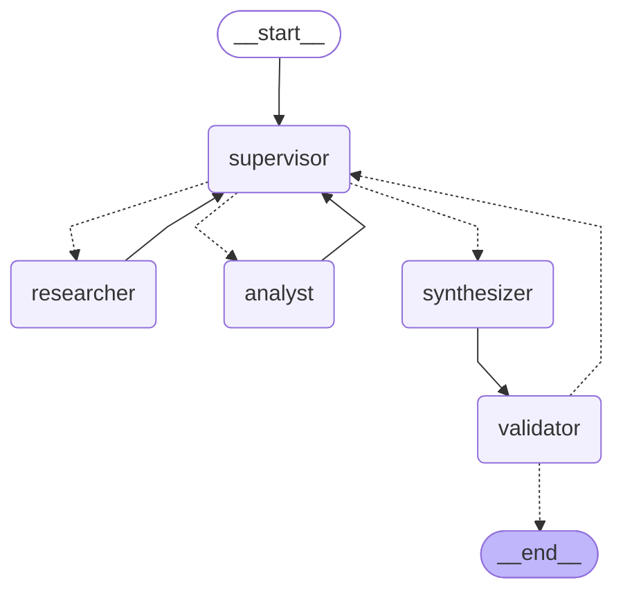

# Orquestador Multi-Agente de Análisis e Investigación

Pre-entrega 6 — Coderhouse AI Engineering. Prototipo en **LangGraph** con topología jerárquica: un **Supervisor** decide en cada paso qué especialista interviene, el **Agente de Investigación** busca evidencia en una Vector DB local (Chroma), el **Agente de Análisis** calcula y analiza sentimiento sobre esos datos, y la respuesta pasa por **Síntesis** y **Validación** antes del `END`.

Dominio: documentación interna de la empresa ficticia TechCorp (políticas de RR. HH. reutilizadas de la pre-entrega de RAG local y una encuesta de clima 2025 con indicadores y comentarios).

## Grafo

Diagrama generado con `graph.get_graph().draw_mermaid()` (`python main.py --graph` lo exporta a `graph.mmd` y, con internet, a `graph.png`):



| Nodo | Rol | Ve | Escribe en el estado |
| --- | --- | --- | --- |
| `supervisor` | Router y controlador de flujo (LLM con salida estructurada `SupervisorDecision`) | Consulta, contribuciones de los especialistas, feedback del validador | `next_agent`, `current_instruction`, `decisions`, `step_count`, `revisions` |
| `researcher` | Agente ReAct (`create_react_agent`) con `buscar_documentos` y `listar_documentos` | Solo la instrucción del supervisor | Una `Contribution` con las fuentes recuperadas |
| `analyst` | Agente ReAct con `calcular`, `estadisticas`, `variacion_porcentual`, `analizar_sentimiento` | La instrucción + los aportes del investigador | Una `Contribution` |
| `synthesizer` | Redacta la respuesta final citando fuentes | Consulta + aportes de investigador y analista | `final_answer` |
| `validator` | Rúbrica determinista antes del `END` | La respuesta y las fuentes recuperadas | `task_completed`, `validation_feedback` |

## Estructura

| Ruta | Qué hace |
| --- | --- |
| `state.py` | `OrchestratorState` (hereda de `MessagesState`), `Contribution` y `Decision` |
| `agents/supervisor.py` | Nodo supervisor, guardas de parada y `route_from_supervisor` (devuelve `Literal`) |
| `agents/research_agent.py` | Agente de Investigación |
| `agents/analyst_agent.py` | Agente de Análisis/Cómputo |
| `agents/synthesizer.py` | Síntesis final, nodo `validator` y `route_from_validator` |
| `agents/common.py` | Construcción y ejecución de los agentes ReAct |
| `tools/retrieval.py` | Corpus, chunking, Chroma y herramientas de búsqueda |
| `tools/calculator.py` | Calculadora segura sobre el AST (sin `eval`), estadísticas y variación porcentual |
| `tools/sentiment.py` | Sentimiento por léxico en español, con negaciones e intensificadores |
| `graph.py` | `build_graph()`: arma el `StateGraph` |
| `prompts.py` | Prompts por rol; el del supervisor contiene la rúbrica de suficiencia |
| `config.py` / `llm.py` | Configuración, límites y `ChatOpenAI` |
| `runner.py` | Ejecución en streaming, traza JSON y exportación del diagrama |
| `observability.py` | Exportador OpenInference hacia Phoenix e instrumentación de OpenAI y LangChain |
| `ingest.py` | Indexa `data/` en `vectorstore/` |
| `main.py` | CLI: una consulta, modo interactivo, `--demo` y `--graph` |
| `demo.ipynb` | Demo del flujo de delegación |
| `tests/` | Tests offline con un LLM falso por rol |

## Por qué esta topología

- **Jerárquica con un único decisor.** La consigna exige que el dato pase del investigador al analista y que alguien juzgue si alcanza. Centralizar esa decisión en el supervisor evita que los especialistas se llamen entre sí y hace el flujo predecible: todo especialista vuelve siempre al supervisor.
- **Especialistas con herramientas acotadas.** El investigador es el único que accede a los documentos y el analista el único que calcula. Así un número de la respuesta siempre tiene un origen claro: fragmento recuperado o herramienta de cálculo.
- **Enrutamiento dinámico, no un pipeline fijo.** Si la consulta solo pide un dato, el supervisor salta el analista; si el analista detecta que le faltan datos, el supervisor puede volver al investigador con una instrucción de refinamiento.
- **Validación separada de la síntesis.** El sintetizador redacta; un nodo determinista verifica. Un LLM no se evalúa a sí mismo.

## Estado compartido

`OrchestratorState` hereda `messages` de `MessagesState` y agrega:

- `contributions: Annotated[list[Contribution], operator.add]`: cada agente **agrega** un registro con `agent`, `instruction`, `content`, `sources` e `iteration`. Nada se sobrescribe, así que siempre se sabe quién aportó qué y en respuesta a qué instrucción.
- `decisions: Annotated[list[Decision], operator.add]`: el razonamiento de cada decisión del supervisor, y si la impuso una guarda (`forced`).
- `next_agent`, `current_instruction`, `step_count`, `revisions`, `validation_feedback`, `validation_attempts`, `final_answer`, `task_completed`.

## Cómo se evitan los errores comunes

**Supervisor infinito.** Hay tres condiciones de parada, todas en código (no dependen de que el LLM "se dé cuenta"):

1. `MAX_STEPS = 8` decisiones del supervisor: al llegar, se fuerza `synthesizer`.
2. `MAX_REVISIONS = 2` re-delegaciones por especialista: una tercera se convierte en síntesis forzada.
3. `MAX_VALIDATION_RETRIES = 1`: si la respuesta vuelve a fallar la validación, termina igual con un aviso visible.

Además, el prompt del supervisor tiene una **rúbrica de suficiencia** estricta (cobertura, evidencia con fuente, cómputo con herramienta, consistencia) y `recursion_limit` actúa como última red.

**Contaminación de contexto.** Cada especialista corre como un agente ReAct aislado que recibe **un solo mensaje**: la instrucción del supervisor. El analista recibe además los aportes del investigador, pero no la consulta original, ni los fragmentos crudos de búsqueda, ni los mensajes del supervisor. El supervisor, a su vez, ve las contribuciones resumidas y no las llamadas internas a herramientas. Los tests verifican exactamente qué mensajes recibe cada modelo.

## Manejo de conflictos entre agentes

- **Un solo escritor por aporte.** Cada agente agrega su `Contribution`; ninguno edita la de otro, y el supervisor es el único que decide el próximo paso.
- **El documento manda.** Si el cálculo del analista no coincide con el dato del investigador (o le faltan datos), la rúbrica obliga al supervisor a re-delegar con una instrucción que nombre el problema; la evidencia documental prevalece sobre cualquier inferencia del modelo.
- **Fuentes verificables.** Las fuentes de una contribución del investigador se extraen de lo que devolvió la herramienta (`ToolMessage`), no de lo que el LLM dice haber leído. El validador rechaza una respuesta que cite un archivo que nadie recuperó o que no cite ninguno habiendo evidencia, y devuelve el control al supervisor con ese feedback.
- **Fallos acotados.** Si un especialista agota sus pasos internos, su aporte lo dice explícitamente en lugar de romper el grafo; el supervisor decide con esa información.

## Puesta en marcha

Requiere ambiente con Python 3.12.

```bash
pip install -r requirements.txt
```

```bash
copy .env.example .env
```

Completa `OPENAI_API_KEY` en `.env` (está en `.gitignore`). El modelo por defecto es `gpt-5.4-mini` (`OPENAI_MODEL` para cambiarlo). Los embeddings son locales (`paraphrase-multilingual-MiniLM-L12-v2`) y se descargan la primera vez.

Indexar el corpus (opcional: la primera búsqueda lo hace sola):

```bash
python ingest.py
```

## Uso

```bash
python main.py --demo
```

```bash
python main.py "¿Cuántos días de teletrabajo permite la política y qué porcentaje de la semana laboral representan?"
```

```bash
python main.py --graph
```

Sin argumentos abre un modo interactivo. Cada ejecución imprime los pasos de delegación y guarda la traza completa en `traces/`.

Ejemplo de salida (abreviado):

```
[supervisor · paso 1] → researcher
    motivo: No hay contribuciones; primero se necesitan los días por antigüedad.
[researcher] Menos de 5 años: 14 días naturales ... [Fuente: politica_vacaciones.md]
    fuentes recuperadas: politica_vacaciones.md, ...
[supervisor · paso 2] → analyst
[analyst] Promedio de 14, 21 y 28 = 21 días; variación de 14 a 28: +100.00%
[supervisor · paso 3] → synthesizer
[synthesizer] ...
[validator] Respuesta aprobada.
```

La demo del flujo está en `demo.ipynb` (se abre con el kernel del `.venv`).

## Observabilidad con Phoenix

Cada ejecución (`main.py`, `ingest.py` y `demo.ipynb`) exporta sus trazas en formato **OpenInference** sobre OTLP/HTTP al servidor local de Phoenix, configurado en `observability.py`:

```bash
phoenix serve
```

| Qué se instrumenta | Cómo | Span en Phoenix |
| --- | --- | --- |
| SDK de OpenAI | `OpenAIInstrumentor` | `LLM`: mensajes, respuesta, tool calls y tokens de cada llamada |
| LangGraph / LangChain | `LangChainInstrumentor` | `CHAIN` por nodo del grafo, `AGENT` por agente ReAct y `TOOL` por herramienta |
| Búsqueda en Chroma | Span manual en `tools/retrieval.py` | `RETRIEVER` `chroma.similarity_search`: consulta, top-k y cada fragmento con id, contenido, metadata y score (distancia) |
| Indexación en Chroma | Span manual en `build_chroma()` | `EMBEDDING` `chroma.add_documents`: modelo de embeddings y cantidad de fragmentos |

Chroma no tiene un instrumentor de OpenInference, por eso sus llamadas se trazan a mano con las convenciones semánticas de OpenInference (`retrieval.documents.*`); así Phoenix las muestra en su vista de documentos recuperados. El span `RETRIEVER` queda anidado dentro del `TOOL` `buscar_documentos`, y este dentro del agente investigador.

Las trazas se ven en <http://localhost:6006>, en el proyecto `orquestador-techcorp`. Las consultas de una misma ejecución de `main.py` comparten un `session_id`, así que la demo o el modo interactivo aparecen agrupados en la pestaña *Sessions*. Variables opcionales en `.env`: `PHOENIX_COLLECTOR_ENDPOINT` (por defecto `http://localhost:6006/v1/traces`), `PHOENIX_PROJECT_NAME` y `PHOENIX_TRACING=false` para desactivar el envío. Si Phoenix no está levantado, el orquestador funciona igual y solo se pierden las trazas.

Las llamadas al modelo aparecen dos veces, una vez por cada instrumentor: el span `LLM` de LangChain (`ChatOpenAI`) contiene al del SDK de OpenAI (`ChatCompletion`), que muestra la petición HTTP real.

## Tests

No usan red ni API key: un `ScriptedChatModel` por rol reemplaza a OpenAI y un vector store en memoria con embeddings deterministas reemplaza a Chroma.

```bash
pytest
```

Cubren las herramientas (incluido que la calculadora rechace código), las guardas de parada, la rúbrica del validador y el grafo completo: la secuencia `supervisor → researcher → supervisor → analyst → supervisor → synthesizer → validator`, el contexto que recibe cada agente, el corte del supervisor indeciso y el reintento por fuentes inventadas.

## Notas

- `create_react_agent` (pedido por la consigna) está marcado como obsoleto en LangGraph 1.x a favor de `langchain.agents.create_agent`; sigue funcionando y se silencia su aviso.
- `draw_mermaid_png()` usa el servicio público mermaid.ink, por eso requiere internet; el Mermaid en texto se genera siempre.
