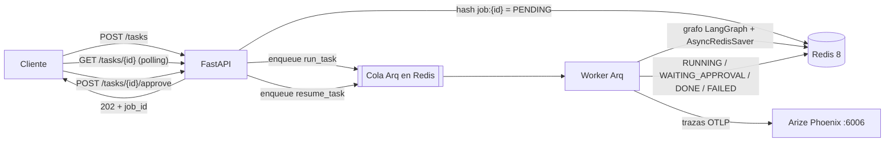
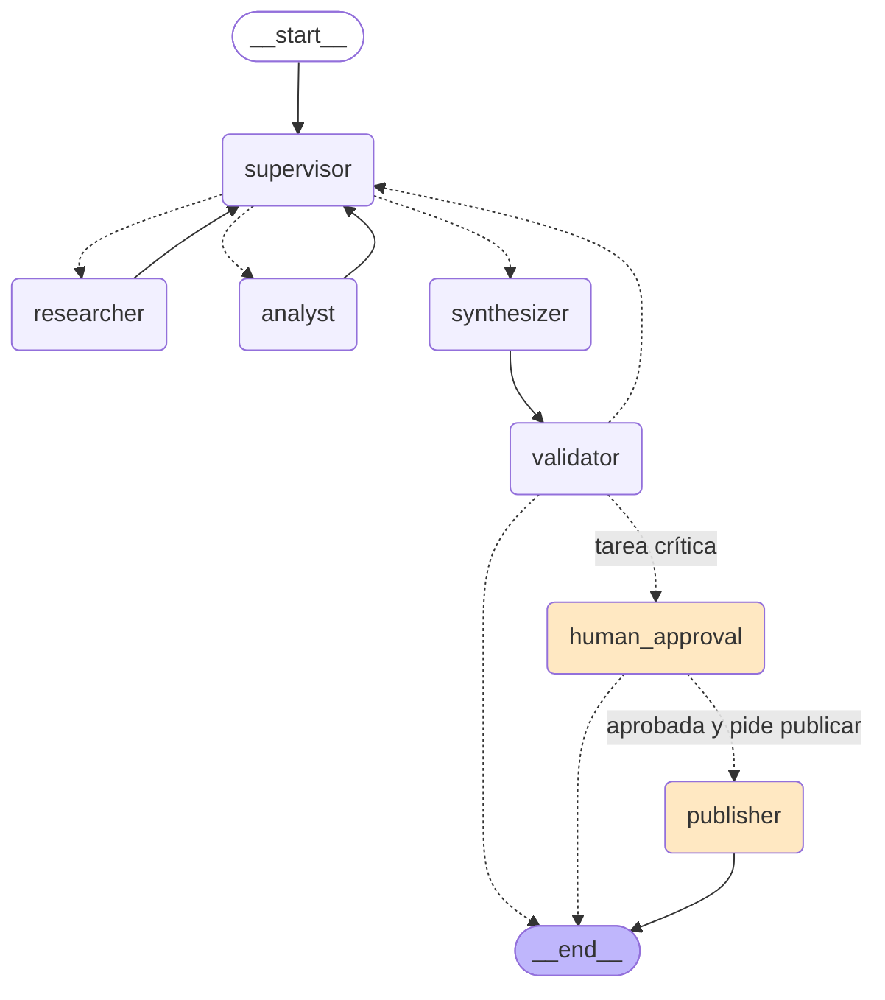

# API de producción del orquestador multi-agente

Pre-entrega 7 — Coderhouse AI Engineering. Expone el orquestador multi-agente del Módulo 6 (Supervisor + Investigador + Analista + Síntesis + Validación, en LangGraph) como una **API REST asíncrona con FastAPI**, con:

1. **Endpoints asíncronos:** `POST /tasks` encola la consulta y devuelve un `job_id` al instante; un worker la procesa en segundo plano.
2. **Estado en Redis:** el estado de cada job (`PENDING`, `RUNNING`, `WAITING_APPROVAL`, `DONE`, `REJECTED`, `FAILED`) y los **checkpoints de LangGraph** (`AsyncRedisSaver`) viven en Redis.
3. **Observabilidad:** cada ejecución envía trazas a **Arize Phoenix** vía OpenInference: un span por nodo del grafo, agente, herramienta y llamada al LLM, con tokens, costo y latencia.
4. **Human-in-the-loop:** las tareas críticas se detienen en un nodo `human_approval` (`interrupt()`) hasta que alguien las aprueba o rechaza en `POST /tasks/{id}/approve`.
5. **Prueba de carga:** `scripts/load_test.py` lanza 5 peticiones concurrentes; el costo por ejecución y la latencia p95 se leen en Phoenix.

## Arquitectura



- La API **nunca ejecuta el grafo**: solo escribe en Redis con `redis.asyncio` y encola en Arq. Ninguna llamada síncrona bloquea el event loop.
- El **worker** (Arq, proceso separado) ejecuta hasta `WORKER_MAX_JOBS` jobs en paralelo. Las partes síncronas del agente (búsqueda en Chroma, embeddings) corren en hilos: LangChain ejecuta las herramientas síncronas en un executor y la carga inicial del vector store usa `asyncio.to_thread`.
- El `job_id` es también el `thread_id` de LangGraph: una tarea en pausa queda guardada en Redis y puede reanudarla cualquier worker, incluso después de un reinicio.

## Grafo



Los nodos del Módulo 6 no cambian su lógica (ver el README de `multi_agent_orchestrator`). Lo nuevo:

| Nodo / pieza | Qué hace |
| --- | --- |
| `route_after_validation` | Si la respuesta fue validada, decide entre `END` y `human_approval` según `assess_risk` |
| `human_approval` | Llama a `interrupt()` con los motivos, la acción pendiente y una vista previa de la respuesta. El grafo se detiene y el checkpoint queda en Redis |
| `publisher` | Ejecuta `publicar_informe`, la herramienta con **efecto lateral** (escribe `reports/informe_{job_id}.md`). Solo se alcanza con aprobación |
| `tokens_used` | Cada nodo suma los tokens que informa el proveedor (`usage_metadata`); el supervisor usa `include_raw=True` para no perderlos |

### ¿Cuándo una tarea es crítica?

`assess_risk` (en `app/hitl.py`) es determinista:

- **Efecto lateral:** el request trae `"publish": true` o la consulta pide publicar o enviar el informe ("publica", "envía", "difunde"...).
- **Costo alto:** la ejecución consumió más de `COST_APPROVAL_TOKEN_THRESHOLD` tokens (60 000 por defecto).

Si se aprueba una tarea con efecto lateral, se publica el informe y el job termina en `DONE`. Si se aprueba una tarea de costo alto, la respuesta se entrega (`DONE`). Si se rechaza, no se publica nada y el job termina en `REJECTED`.

## Estados de un job

| Estado | Significado |
| --- | --- |
| `PENDING` | Encolado (o reencolado tras la aprobación), esperando un worker |
| `RUNNING` | El worker está ejecutando el grafo |
| `WAITING_APPROVAL` | Pausado en `human_approval`; `approval_request` explica qué se pide aprobar |
| `DONE` | Terminado; `result` trae la respuesta, la ruta del supervisor, los tokens y, si corresponde, el informe publicado |
| `REJECTED` | Un revisor rechazó la acción crítica |
| `FAILED` | Ocurrió una excepción o se superó `JOB_TIMEOUT_SECONDS`; `error` trae el tipo y el mensaje |

**Manejo de errores en segundo plano:** `process_job` (en `app/worker.py`) envuelve la ejecución en `try/except` y en `asyncio.timeout`. Cualquier excepción del agente, del LLM o de Redis deja el job en `FAILED` con el error, de modo que el cliente que hace polling siempre llega a un estado terminal. Además, Arq está configurado con `max_tries=1` para no reintentar a ciegas y con un `job_timeout` de respaldo. La aprobación usa una transición atómica (`WATCH`/`MULTI`) de `WAITING_APPROVAL` a `PENDING`, así dos aprobaciones simultáneas no reanudan el grafo dos veces.

## Estructura

| Ruta | Qué hace |
| --- | --- |
| `app/main.py` | FastAPI: `POST /tasks`, `GET /tasks/{id}`, `GET /health` |
| `app/hitl.py` | Criterio de criticidad, nodos `human_approval` y `publisher`, y `POST /tasks/{id}/approve` |
| `app/graph.py` | `build_graph()` del Módulo 6 con los nodos HITL y `redis_checkpointer()` (`AsyncRedisSaver`) |
| `app/worker.py` | Worker de Arq: `run_task`, `resume_task` y las transiciones de estado |
| `app/jobs.py` | `JobStore`: estado de los jobs en Redis (hash `job:{id}`) |
| `app/observability.py` | `phoenix.otel.register`, `LangChainInstrumentor` y el `tracer` para decoradores |
| `app/schemas.py` | Modelos Pydantic de la API |
| `app/agents/`, `app/tools/`, `app/state.py`, `app/prompts.py` | Orquestador del Módulo 6 (con conteo de tokens) y `tools/publisher.py` |
| `app/data/` | Corpus de TechCorp que indexa el Agente de Investigación |
| `scripts/load_test.py` | Prueba de carga con 5 peticiones concurrentes |
| `tests/` | Tests sin red ni API key (LLM guionado, Redis falso con `fakeredis`) |
| `screenshots/` | Capturas del dashboard de Phoenix |

## Puesta en marcha

Requiere Python 3.12 y Docker. Primero copia la configuración y completa `OPENAI_API_KEY`:

```bash
copy .env.example .env
```

### Opción A: todo con Docker Compose (recomendada)

Levanta Redis, Phoenix, la API y el worker:

```bash
docker compose up -d --build
```

- API y documentación interactiva: http://localhost:8000/docs
- Dashboard de Phoenix: http://localhost:6006

La primera ejecución del worker descarga el modelo de embeddings y crea el índice de Chroma (quedan en volúmenes de Docker). Los informes publicados aparecen en `reports/`.

### Opción B: Redis y Phoenix en Docker, API y worker en local (Windows)

1. Inicia solo la infraestructura:

```bash
docker compose up -d redis phoenix
```

2. En un entorno virtual instala las dependencias:

```bash
pip install -r requirements.txt
```

3. En una terminal, inicia el worker:

```bash
arq app.worker.WorkerSettings
```

4. En otra terminal, inicia la API:

```bash
uvicorn app.main:app --port 8000
```

Con el `.env` de ejemplo, `REDIS_URL` apunta a `localhost:6379` y las trazas a `http://localhost:6006/v1/traces`.

**Sobre Redis:** el checkpointer de LangGraph (`langgraph-checkpoint-redis`) necesita los módulos RedisJSON y RediSearch. La imagen `redis:8` ya los incluye; con un Redis más antiguo usa `redis/redis-stack-server`.

**Sobre Phoenix:** desde la versión 21 Phoenix activa la autenticación por defecto. En el `docker-compose.yml` se desactiva (`PHOENIX_ENABLE_AUTH=false`) porque es un dashboard local de desarrollo; en un entorno compartido, actívala y define `PHOENIX_API_KEY` en el `.env`.

## Uso de la API

Crear una tarea (responde `202` con el `job_id` sin esperar al agente):

```bash
curl -X POST http://localhost:8000/tasks -H "Content-Type: application/json" -d "{\"query\": \"¿Cuántos días de teletrabajo permite la política y qué porcentaje de la semana representan?\"}"
```

```json
{"job_id": "3cd1427b354440f89b96b8835405d741", "status": "PENDING", "status_url": "/tasks/3cd1427b354440f89b96b8835405d741"}
```

Consultar el estado (polling):

```bash
curl http://localhost:8000/tasks/3cd1427b354440f89b96b8835405d741
```

Crear una tarea crítica (pide publicar el informe):

```bash
curl -X POST http://localhost:8000/tasks -H "Content-Type: application/json" -d "{\"query\": \"Calcula la variación del eNPS 2025 respecto de 2024 y publica el informe\", \"publish\": true}"
```

Cuando su estado pase a `WAITING_APPROVAL`, `approval_request` muestra los motivos y una vista previa. Para aprobarla (o rechazarla con `"approved": false`):

```bash
curl -X POST http://localhost:8000/tasks/<job_id>/approve -H "Content-Type: application/json" -d "{\"approved\": true, \"comment\": \"Revisado por RR. HH.\"}"
```

Errores: `404` si el job no existe, `409` si se intenta aprobar un job que no está en `WAITING_APPROVAL`, `422` si el cuerpo es inválido y `503` si Redis o la cola no responden.

## Prueba de carga: 5 peticiones concurrentes

Con la API y el worker en marcha:

```bash
python scripts/load_test.py --auto-approve
```

El script envía 5 consultas a la vez (una de ellas crítica, que se aprueba automáticamente con `--auto-approve`; sin esa opción queda en `WAITING_APPROVAL` para aprobarla a mano), hace polling con backoff hasta que cada job termina e imprime la latencia extremo a extremo de cada uno y los percentiles p50/p95 del lado del cliente.

Las capturas están en [`screenshots/`](screenshots/README.md).

## Tests

No usan red, API key, Redis ni Phoenix: un `ScriptedChatModel` por rol reemplaza a OpenAI, un vector store en memoria reemplaza a Chroma, `fakeredis` reemplaza a Redis y `InMemorySaver` al checkpointer.

```bash
pytest
```

Cubren, además de los tests del Módulo 6:

- **API:** `POST /tasks` responde 202 y encola; 404, 409 y 422; doble aprobación rechazada; fallo de la cola → `FAILED`.
- **Worker:** flujo feliz → `DONE`; excepción → `FAILED` con el error; timeout → `FAILED`; tarea crítica → `WAITING_APPROVAL` → aprobada → `DONE` con informe; rechazada → `REJECTED` sin informe.
- **HITL:** la pausa ocurre antes del efecto lateral, la reanudación publica, el rechazo no publica, la detección por verbos y el umbral de tokens.